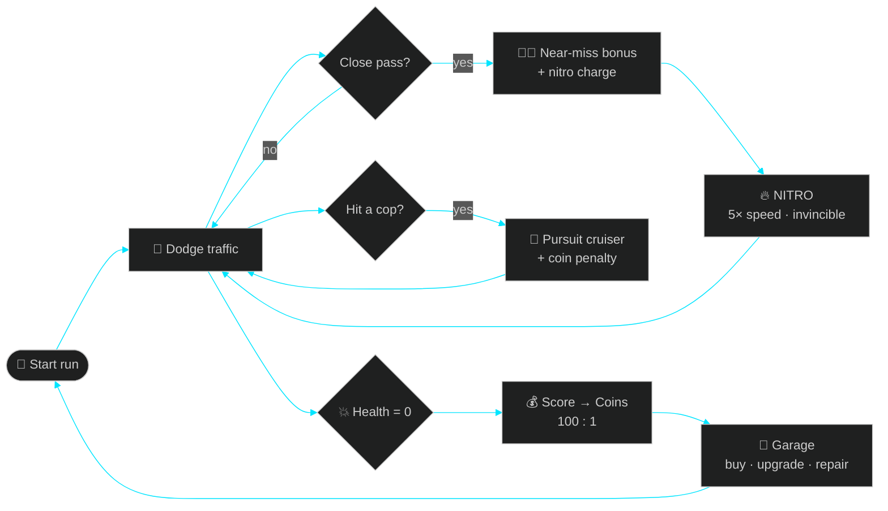
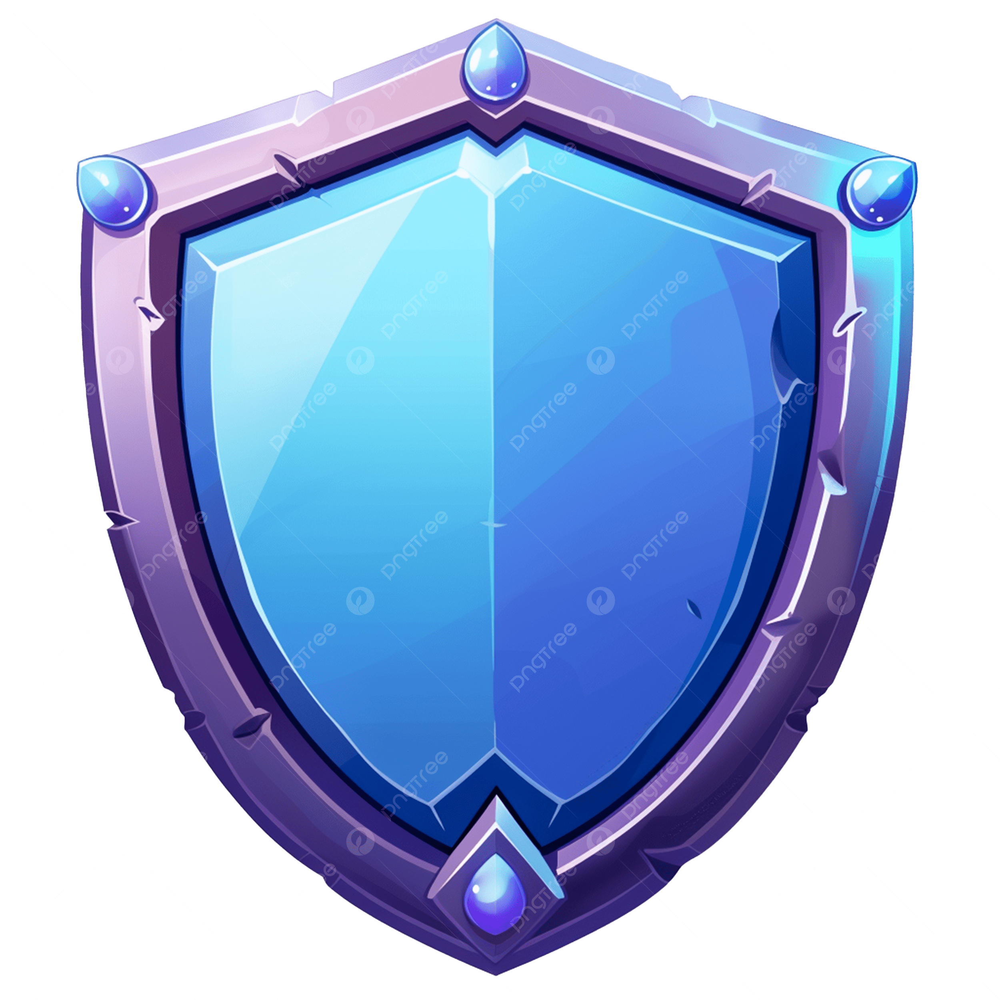
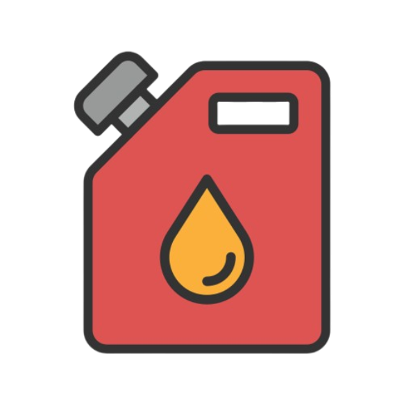
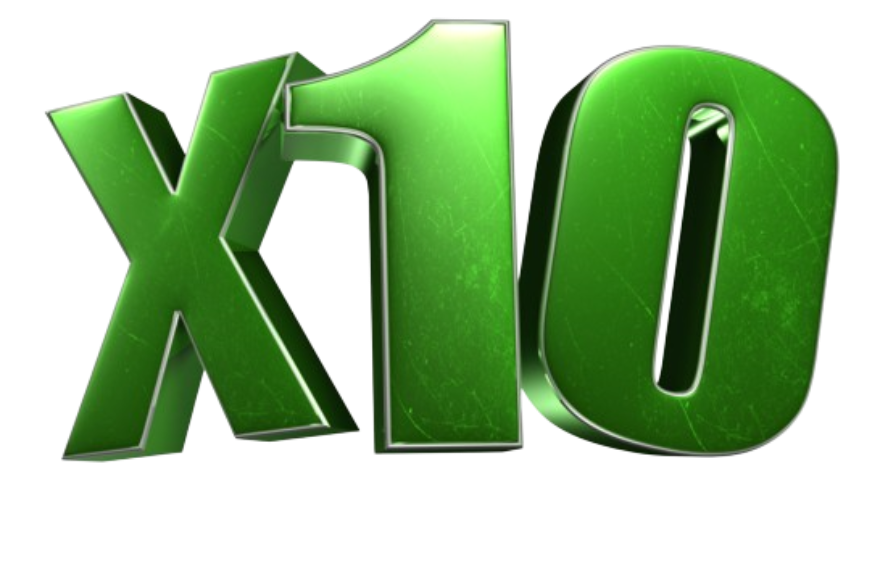
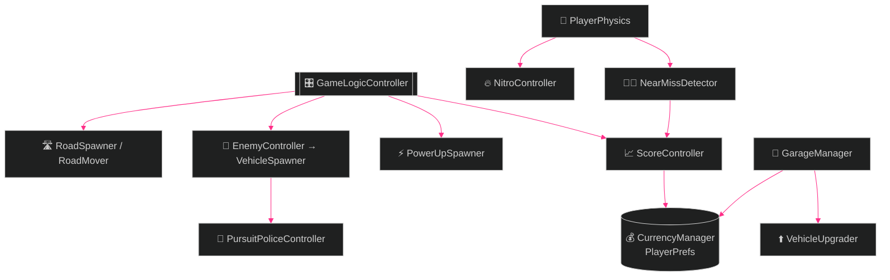

<div align="center">



<a href="#-gameplay">
  
</a>

<p>
  
  
  
  
  
</p>

<h3>🏁 An endless neon traffic-dodger where the road never ends and the cops never forget.</h3>

<b>
  <a href="#-gameplay">Gameplay</a> ·
  <a href="#-features">Features</a> ·
  <a href="#-controls">Controls</a> ·
  <a href="#-power-ups">Power-ups</a> ·
  <a href="#-the-garage">Garage</a> ·
  <a href="#-under-the-hood">Under the hood</a> ·
  <a href="#-getting-started">Setup</a>
</b>

</div>

<br/>


## 🎮 Gameplay

> *The road never ends. The traffic never stops. Your only job: **stay alive and score big.***

Skim past cars for **near-miss** bonuses, ride alongside traffic to charge your **nitro**, then hit <kbd>Space</kbd> and plow through everything at **5× speed**. Every run converts into coins you can spend in the **garage** on faster cars, upgrades and repairs.

Just don't ram the police. They *will* come after you. 🚨

<!-- 📸 Drop gameplay captures into docs/ and uncomment:
<p align="center">
   
</p>
-->




## ✨ Features

<table>
<tr>
<td width="33%" valign="top">

#### 🛣️ Endless Road
Road segments, pavements and background roads spawn and recycle on the fly. It never runs out.

</td>
<td width="33%" valign="top">

#### 🚙 Dense Traffic
Hatchbacks, pickups, vans, taxis, tow trucks and big trucks fight for every lane.

</td>
<td width="33%" valign="top">

#### 😮‍💨 Near-Miss Combos
Close passes trigger camera shake, effects and bonus score. Simultaneous near-misses **stack**.

</td>
</tr>
<tr>
<td valign="top">

#### 🔥 Nitro Slipstream
Drive beside traffic to charge. While active you get **5× speed, 10× mass and invincibility**. Cars get shoved aside or destroyed.

</td>
<td valign="top">

#### 🚨 Police Pursuit
Hit a cop and a **pursuit cruiser** spawns behind you. It closes in, tracks your lane and may **ram** you.

</td>
<td valign="top">

#### 🌅 Day / Night Cycle
The sun keeps rolling across the sky, so the mood shifts the longer you survive.

</td>
</tr>
<tr>
<td valign="top">

#### 🏪 Garage & Upgrades
Buy cars with coins and upgrade them for **+20 %** on every stat.

</td>
<td valign="top">

#### 🔧 Damage & Repair
Wrecked cars need a repair timer. Skip it with 💎 diamonds or a (placeholder) ad.

</td>
<td valign="top">

#### 🔊 Full Audio
Engine, acceleration, crash and intro SFX plus a shuffled background playlist.

</td>
</tr>
</table>


## 🎯 Controls

<div align="center">

| Action | Keys |
|:---:|:---:|
| ⬅️ ➡️ Steer | <kbd>A</kbd> <kbd>D</kbd> &nbsp;or&nbsp; <kbd>←</kbd> <kbd>→</kbd> |
| ⏫ Accelerate | <kbd>W</kbd> &nbsp;or&nbsp; <kbd>↑</kbd> |
| ⏬ Brake | <kbd>S</kbd> &nbsp;or&nbsp; <kbd>↓</kbd> |
| 🔥 Nitro | <kbd>Space</kbd> |

</div>


## ⚡ Power-ups

<div align="center">
<table>
<tr>
<td align="center" width="170"><br/><b>❤️ Health</b><br/><sub>Patch up your ride</sub></td>
<td align="center" width="170"><br/><b>🛡️ Shield</b><br/><sub>Block incoming damage</sub></td>
<td align="center" width="170"><br/><b>🔥 Nitro</b><br/><sub>Instant boost charge</sub></td>
<td align="center" width="170"><br/><b>✖️10 Score</b><br/><sub>Timed score multiplier</sub></td>
</tr>
</table>
</div>


## 🏪 The Garage

| | |
|---|---|
| 💰 **Coins** | Earned every run: **100 score = 1 coin**. Saved between sessions. |
| 💎 **Diamonds** | Premium currency for **instant repairs**. |
| ⬆️ **Upgrade** | ×1.2 to max speed, acceleration, steering, health and nitro capacity. Nitro drains slower too. |
| 🔧 **Repair** | A crashed car is out of action until its repair timer ends, or you pay to fix it now. |
| 🚓 **Police penalty** | Hitting cops costs **50 %** of the coins earned that run, plus a fee per police near-miss. |


## 🧠 Under the Hood



<details>
<summary><b>📋 System reference</b></summary>
<br/>

| System | Role |
|---|---|
| `GameLogicController` | Singleton state machine: start, game over, crash slow-down, police penalties |
| `PlayerPhysics` | Speed, steering, drift and health events (`OnHealthChanged`, `OnHealthDepleted`) |
| `NitroController` + `NitroStackZone` | Slipstream charging, speed and mass boost |
| `NearMissDetector` | Trigger-based close-pass detection with simultaneous-combo window |
| `PursuitPoliceController` | Coroutine chase: *approach → follow → ram or retreat* |
| `GarageManager` + `VehicleUpgrader` | Ownership, upgrades, repair timers; upgrades apply to the spawned instance, never the prefab |
| `CurrencyManager` | `DontDestroyOnLoad` singleton saving coins, diamonds and high score |
| `DayNightCycle` | Rotates the directional light continuously |

</details>

<details>
<summary><b>📁 Project structure</b></summary>
<br/>

```
Assets/
├── Scenes/                 GameScene (main), Game1, SampleScene
├── Prefabs/
│   ├── Cars/               Player cars · traffic · Police · Pursuit Police
│   ├── PowerUp/            Heal · Nitro · Shield · Score ×10 · Death Panel
│   ├── Roads/ Pavements/   Road & roadside prefabs (incl. police roadblocks)
│   └── Spawners.prefab
├── Scripts/
│   ├── Audio Scripts/      AudioManager, Sound
│   ├── Enemy Scripts/      Traffic AI, police, pursuit, spawners, damage
│   ├── Logic Scripts/      Game logic, currency, garage, upgrades, near-miss, score
│   ├── Player Scripts/     Physics, nitro, invincibility, camera, audio
│   ├── PowerUp Scripts/    Spawner, mover, each power-up type
│   ├── Road Scripts/       Road spawner/mover/segment, pavements, fake road
│   ├── UI Scripts/         Start menu, HUD, garage, death screen
│   └── Editor/             CurrencyDebugger, MaterialConverterToURP, RemoveDebugLogs
├── SFX/ · BackGroundMusic/ Audio
└── FreeAssests/            Third-party environment & prop packs
```

</details>


## 🚀 Getting Started

```bash
git clone https://github.com/PhuNgao123/Trafic-Chaos-No-Brain-Drive.git
```

| Step | |
|:---:|---|
| **1** | Install **Unity 6000.3.1f1** via Unity Hub |
| **2** | *Add project from disk*. Packages import and `Library/` rebuilds automatically |
| **3** | Open `Assets/Scenes/GameScene.unity` |
| **4** | Press **▶ Play** |

<details>
<summary><b>🐞 Debug helpers</b></summary>
<br/>

- `CurrencyManager` has editor-only toggles (`applyTestCoins`, `applyTestDiamonds`) to grant currency instantly.
- `CurrencyDebugger` and `DataResetButton` inspect and wipe saved data.
- `RemoveDebugLogs` strips debug logging for cleaner builds.

</details>

<details>
<summary><b>📦 Key packages</b></summary>
<br/>

`Universal RP 17.3` · `Input System 1.17` · `Post Processing 3.5` · `TextMesh Pro` · `Timeline` · `AI Navigation`

</details>

## 📝 Notes & Credits

- 🎨 Environment and prop art come from third-party packs in `Assets/FreeAssests`. Check each license before redistributing.
- 🎵 Tracks in `Assets/BackGroundMusic` are commercial songs. **Replace them with licensed or royalty-free music before publishing.**
- 📺 The "watch ad" repair button is a placeholder and isn't connected to an ads SDK.

<br/>

<div align="center">
  
  <sub>Built with Unity 6 · Made with ❤️ and questionable driving decisions</sub>
</div>
