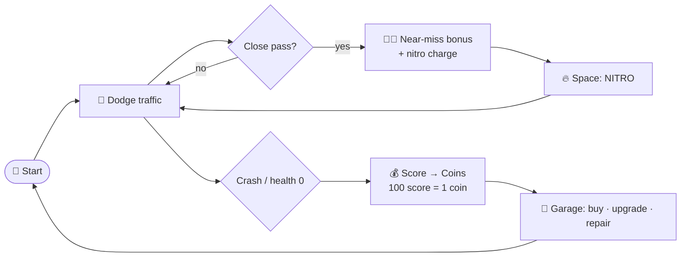

<div align="center">


<a href="https://git.io/typing-svg">
  
</a>

<br/>


**An endless 3D arcade traffic-dodger. Survive the rush hour, chain near-misses, and turn every run into coins.**

[🎮 About](#-about) · [✨ Features](#-features) · [🕹️ How to Play](#️-how-to-play) · [⚡ Power-ups](#-power-ups) · [🧱 Structure](#-project-structure) · [🛠️ Setup](#️-getting-started)

</div>

---

## 🎮 About

The road never ends, the traffic never stops, and your only job is to **stay alive and score big**.

Skim past cars for **near-miss** bonuses, hug traffic to charge **nitro**, then smash through everything at **5× speed**. Cash your score in at the garage for faster cars, upgrades and repairs — but don't ram the police. They *will* come after you. 🚨

<!-- 📸 Add gameplay screenshots / GIF here:
<p align="center"></p> -->

## ✨ Features

<table>
<tr>
<td width="50%" valign="top">

### 🛣️ Endless Procedural Road
Road segments, pavements and fake background roads spawn and recycle on the fly — it never runs out.

### 🚙 Dense AI Traffic
Hatchbacks, pickups, vans, taxis, tow trucks and big trucks fight for your lane.

### 😮‍💨 Near-Miss Scoring
Pass close to cars for camera shake, effects and bonus score. Simultaneous near-misses **stack**.

### 🌅 Day / Night Cycle
The sun keeps rotating, so the mood shifts the longer you survive.

</td>
<td width="50%" valign="top">

### 🔥 Nitro Slipstream
Drive beside traffic to charge nitro. Active: **5× speed · 10× mass · invincible** — cars get shoved or destroyed.

### 🚨 Police Pursuit
Hit a cop and a **pursuit cruiser** spawns behind you, chases, and may ram. Police hits cost you coins.

### 🏪 Garage & Upgrades
Buy cars with coins, upgrade them (**×1.2** to all stats) and preview stats before you pick.

### 🔧 Damage & Repair
Wrecked cars need a repair timer — or pay 💎 diamonds / watch an ad for an instant fix.

</td>
</tr>
</table>

## 🕹️ How to Play



1. Press **Start** — you need a car that is *owned* and *ready* (not broken).
2. **Steer** left/right to dodge traffic.
3. Press **Space** to unleash **nitro**.
4. Avoid police: a hit costs **50 %** of your earned coins, plus a flat fee per police near-miss.
5. When health hits zero your score converts to coins. Spend them in the garage.

> Controls use Unity's **Input System** — see `Assets/InputSystem_Actions.inputactions` for bindings.

## ⚡ Power-ups

<table align="center">
<tr>
<td align="center" width="140"><br/><b>Health</b><br/><sub>Restore HP</sub></td>
<td align="center" width="140"><br/><b>Shield</b><br/><sub>Block damage</sub></td>
<td align="center" width="140"><br/><b>Nitro</b><br/><sub>Instant boost charge</sub></td>
<td align="center" width="140"><br/><b>Score ×10</b><br/><sub>Timed multiplier</sub></td>
</tr>
</table>

## 🧱 Project Structure

```
Assets/
├── Scenes/                 GameScene (main), Game1, SampleScene
├── Prefabs/
│   ├── Cars/               Player · traffic · Police · Pursuit Police
│   ├── PowerUp/            Heal · Nitro · Shield · Score ×10 · Death Panel
│   ├── Roads/ Pavements/   Road & roadside prefabs (incl. police roadblocks)
│   └── Spawners.prefab
├── Scripts/
│   ├── Audio Scripts/      AudioManager, Sound
│   ├── Enemy Scripts/      Traffic AI, police, pursuit police, spawners, damage
│   ├── Logic Scripts/      GameLogicController, Currency, Garage, Upgrader,
│   │                       NearMissDetector, Score, DayNightCycle, PlayerSpawner
│   ├── Player Scripts/     PlayerPhysics, Nitro*, Invincibility, Camera, Audio
│   ├── PowerUp Scripts/    Spawner, mover, each power-up type
│   ├── Road Scripts/       Road spawner/mover/segment, pavements, fake road
│   ├── UI Scripts/         Start menu, HUD, garage UI, death screen
│   └── Editor/             CurrencyDebugger, MaterialConverterToURP, RemoveDebugLogs
├── SFX/ · BackGroundMusic/ Audio assets
└── FreeAssests/            Third-party environment & prop packs
```

<details>
<summary><b>🧠 Architecture at a glance</b></summary>

<br/>

| System | Role |
|---|---|
| `GameLogicController` | Singleton state machine: start, game over, crash slow-down, police penalties |
| `PlayerPhysics` | Speed, steering, drift, health events (`OnHealthChanged`, `OnHealthDepleted`) |
| `NitroController` + `NitroStackZone` | Slipstream charging, speed/mass boost |
| `PursuitPoliceController` | Coroutine chase: *approach → follow → ram or retreat* |
| `GarageManager` + `VehicleUpgrader` | Ownership, upgrades, repair timers (upgrades applied to the instance, never the prefab) |
| `CurrencyManager` | `DontDestroyOnLoad` singleton saving coins, diamonds, high score via `PlayerPrefs` |

</details>

## 🛠️ Getting Started

**Requirements:** Unity **6000.3.1f1** (Unity 6) with Universal Render Pipeline.

```bash
git clone https://github.com/PhuNgao123/Trafic-Chaos-No-Brain-Drive.git
```

1. Open the folder in **Unity Hub** (packages import and `Library/` rebuilds automatically).
2. Open `Assets/Scenes/GameScene.unity`.
3. Press **▶ Play**.

<details>
<summary><b>🐞 Debug helpers</b></summary>

- `CurrencyManager` has editor-only checkboxes (`applyTestCoins`, `applyTestDiamonds`) to grant currency instantly.
- `CurrencyDebugger` and `DataResetButton` inspect and reset saved data.
- `RemoveDebugLogs` strips debug logging for cleaner builds.

</details>

## 📦 Key Packages

`Universal RP 17.3` · `Input System 1.17` · `Post Processing 3.5` · `TextMesh Pro` · `Timeline` · `AI Navigation`

## 📝 Notes & Credits

- Environment and prop art come from third-party packs in `Assets/FreeAssests` — check each license before redistributing.
- Tracks in `Assets/BackGroundMusic` are commercial songs; **replace them with licensed / royalty-free music before publishing**.
- The "watch ad" repair button is a **placeholder**, not connected to an ads SDK.

<div align="center">


*Made with ❤️ and questionable driving decisions.*

</div>
